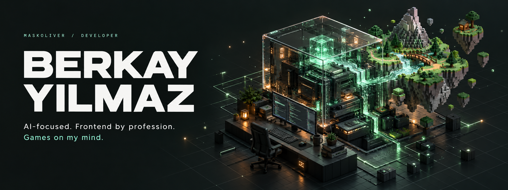
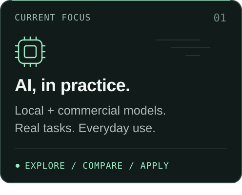
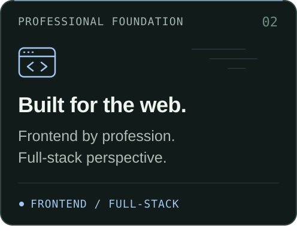
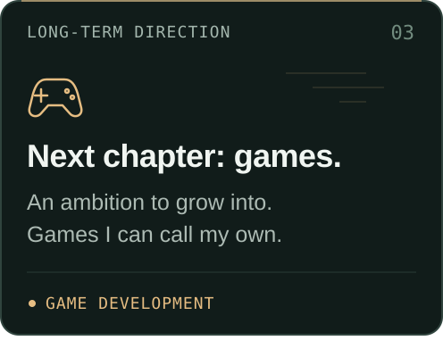
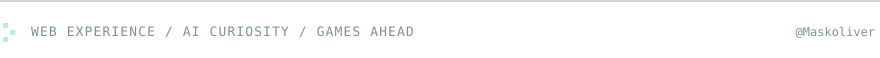

  

  <picture>
    <source media="(max-width: 600px)" srcset="./assets/status-mobile.svg" />
    
  </picture>

<h3 align="center">Frontend experience. Full-stack perspective. AI in daily use.</h3>

  Hey, I'm <strong>Berkay</strong> — an AI-focused developer working in frontend. 
  I use AI throughout nearly all my development work and experiment with 
  local and commercial models in everyday life. Game development is where I want to grow next.

 

  
  
  

 

  
<strong>A little more about how I work &amp; where I'm headed</strong>

### AI is part of my everyday workflow

I use AI in nearly all of my development work. I also test local and commercial models outside work, exploring what they're useful for and how they compare on real tasks.

### The web is my professional foundation

I work as a frontend developer and bring full-stack knowledge to the work I do. My interest in AI builds on that experience.

### Games are a long-term ambition

I want to grow into game development and build games of my own. It's a direction I care about alongside my work in web development and my experiments with AI.

 

  

  <picture>
    <source media="(max-width: 600px)" srcset="./assets/footer-mobile.svg" />
    
  </picture>

